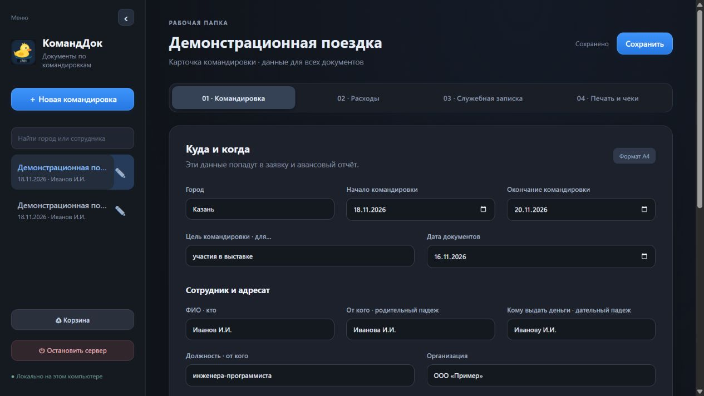
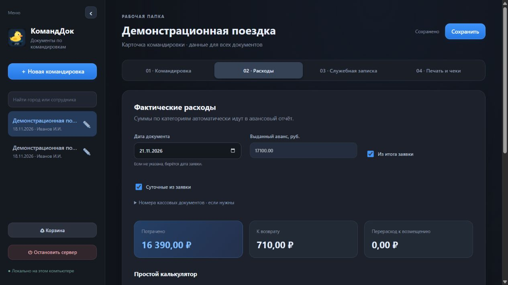
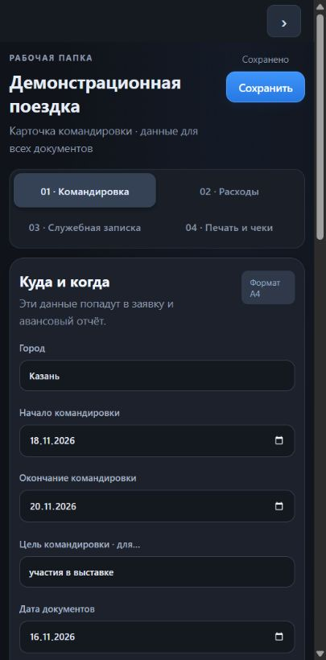
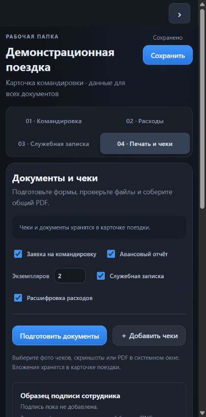

# KomandDok · КомандДок

**Карточка поездки, авансовый отчёт и чеки в одном месте.** Заполните сведения о командировке один раз, внесите фактические расходы и соберите документы с приложениями в один PDF для печати или отправки.

[Скачать для Windows](https://github.com/jeronimo701/KomandDok/releases/download/snapshot-2026-11-16/KomandDok-Portable.zip) · [Скачать APK для Android](https://github.com/jeronimo701/KomandDok/releases/download/snapshot-2026-11-16/KomandDok-Android.apk) · [Страница релиза](https://github.com/jeronimo701/KomandDok/releases/tag/snapshot-2026-11-16)

## Что умеет

- **Карточка командировки:** город, даты, цель, данные сотрудника и плановые суммы. При следующей поездке можно использовать сохранённые реквизиты.
- **Расходы и расчёт:** билеты, жильё, суточные, такси и прочие расходы. Суммы можно вводить выражениями, например 800 × 3. Приложение считает остаток аванса или перерасход.
- **Формы и чеки:** заявка, авансовый отчёт, служебная записка и расшифровка расходов. Можно приложить чеки в PDF или изображениях, выбрать нужные формы и число копий.
- **Предпросмотр и печать:** проверка страниц перед сборкой, общий PDF с формами и чеками. При необходимости можно добавить изображение подписи и настроить его положение на форме.
- **Локальные данные:** поездки и вложения сохраняются на устройстве. Между Windows и Android автоматической синхронизации нет.

## Скриншоты

На всех снимках — вымышленная поездка. Мобильные снимки показывают интерфейс Android в браузерном предпросмотре.

**Windows — карточка командировки**

**Windows — фактические расходы и остаток аванса**

**Android — карточка и вкладка «Печать и чеки»**

 

## Как запустить

| Платформа | Порядок запуска |
|---|---|
| **Windows x64** | Распакуйте ZIP в доступную для записи папку и запустите **J701.exe**. Приложение откроется в браузере и останется в трее. Python и Microsoft Office не нужны. |
| **Android 7.0+** | Установите **KomandDok-Android.apk** на arm64-v8a или x86_64. APK версии 1.3.1 подписан отладочным ключом и распространяется вне Google Play. |

Для обновления Windows остановите приложение и замените J701.exe, сохранив папки «Данные» и «Печать». При несовместимой подписи Android не удаляйте старую установку без сохранения нужных PDF: удаление приложения удаляет его локальные карточки.

## Сборка из исходников

- **Windows:** Python 3.13; установите зависимости командой `python -m pip install -r requirements-build.txt`. Для запуска из исходников — `python Командировки.py`; для portable — `python build_release.py --output путь-к-новой-папке`.
- **Android:** Java 17, Android SDK 35, Python 3.13. В папке android/ выполните `gradlew.bat :app:assembleDebug :app:lintDebug`. [Больше о сборке и проверке Android](android/README.md).

Приложение ранее называлось «Автозаполнение командировок». Авторские материалы доступны по [лицензии для личного использования](LICENSE.txt); сторонние компоненты сохраняют [свои лицензии](THIRD-PARTY.md).
